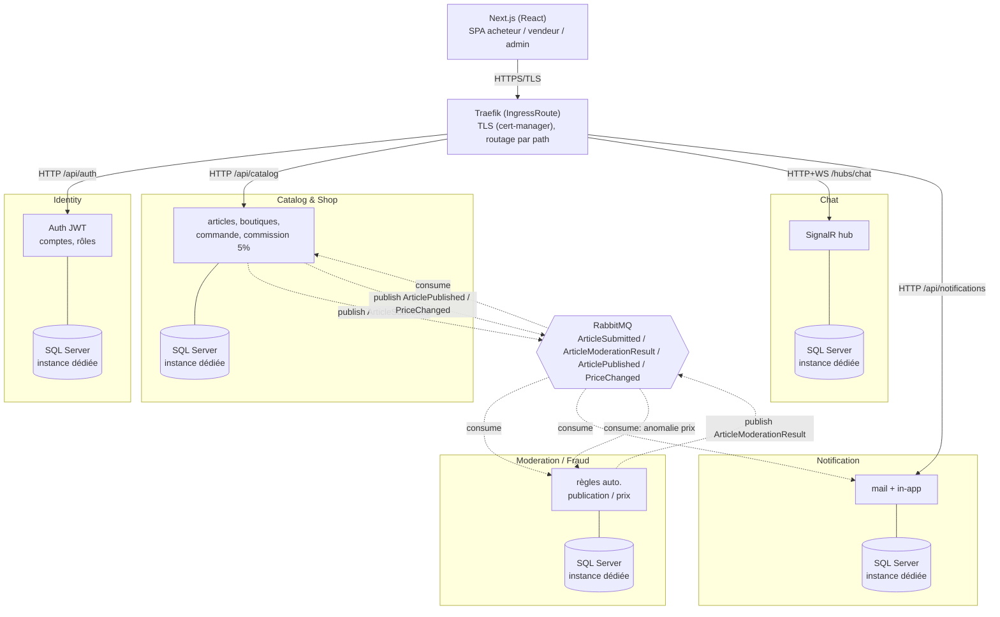
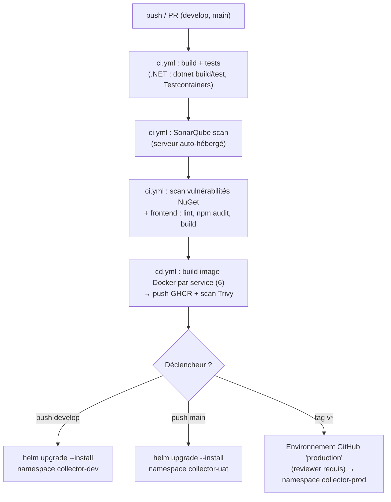

# Collector.shop — Bloc "Superviser et assurer le développement des applications logicielles"

> README de pilotage de projet. Il centralise les consignes, le contexte métier, les décisions
> d'architecture déjà actées, et surtout les **questions encore ouvertes**. À relire/mettre à jour
> à chaque session de travail — c'est la source de vérité pour tous les prompts futurs sur ce repo.

- **Évaluation** : Bloc individuel *Superviser et assurer le développement des applications logicielles* (CESI, INFMAALSIA2V)
- **Rôle joué** : Lead Developer chez Collector (start-up fictive)
- **Format de rendu** : Soutenance orale 20 min + 15 min d'échange, devant un public "spécialiste du développement" (pas de vulgarisation)
- **Échéance cible** : soutenance dans **~1 à 2 mois** à partir du 2026-10-11 (date exacte non fixée — voir [Questions ouvertes](#questions-ouvertes))
- **Documents sources** (à la racine du repo, ne pas modifier) :
  - `Consignes eval bloc Superviser et Assurer Développment.pdf`
  - `contexte_Collector.pdf`
  - `Grille_eval_bloc_INFMAALSIA2V_Superviser_dev_apps_logicielles.xlsx`

---

## 1. Contexte métier (résumé)

**Collector** est une start-up française (5 ans d'existence), historiquement événementielle (salons
d'objets de collection "du quotidien" : baskets éditions limitées, posters dédicacés, figurines,
cassettes V2000...), qui vient de lever des fonds en crowdfunding pour lancer **Collector.shop**,
une marketplace web de vente d'objets de collection **entre particuliers**.

- Commission de **5 %** prélevée par Collector sur chaque transaction.
- Équipe IT toute récente : 1 Lead Dev (= moi dans l'exercice), 2 dev confirmé·e·s (5 ans d'XP).
  Embauches futures possibles, pas de contrainte budget/RH dans l'exercice (mais rester réaliste,
  pas de "mouton à 5 pattes").
- SI existant limité : Office 365 Business Standard, Power BI, Exchange, Adobe CC, laptops Windows 11,
  1 Mac (design), site vitrine WordPress hébergé en France. **Rien d'existant côté app** — tout est à
  construire.

### Rôles utilisateurs

| Rôle | Capacités |
|---|---|
| **Visiteur** (non authentifié) | Parcours du catalogue uniquement |
| **Acheteur** | Inscription obligatoire pour acheter. Espace dédié (achats en cours, historique, notifications, chat). Recommandations selon centres d'intérêt paramétrables. |
| **Vendeur** | Inscription obligatoire pour vendre. Peut aussi être acheteur. Peut créer **plusieurs boutiques virtuelles**, doit être identifié comme vendeur particulier. Espace dédié (ventes en cours, historique, notifications, chat). |
| **Admin** | Back-office : gestion des catégories (lui seul peut en créer), suppression d'articles/vendeurs hors charte, modération du chat. |

### Règles métier clés

- Chat acheteur ↔ vendeur accessible depuis les espaces dédiés ; modération possible par l'admin.
- Paiement **uniquement via la plateforme** (carte bancaire pour la v1) — les échanges d'infos
  personnelles (email, téléphone) entre acheteur/vendeur doivent être **techniquement empêchés**
  (anti-contournement du paiement).
- Chaque article : photos + description + prix + frais de port. **Contrôle avant mise en ligne**,
  à automatiser au maximum (le moins d'intervention humaine possible).
- Changement de prix → (1) notifier les acheteurs intéressés, (2) notifier un composant back-office
  anti-fraude.
- La direction veut pouvoir **brancher** un outil de détection de fraude/anomalie (prix suspect,
  vendeur suspect) — build vs buy non tranché, l'architecture doit juste le permettre.
- Notifications : nouvel article, article correspondant à un centre d'intérêt — paramétrables,
  visibles dans l'espace perso + envoyées par email.
- Contraintes transverses : **internationalisation**, **accessibilité**, **sécurité de premier plan**
  (transactions financières), **architecture évolutive** (facilité d'ajout de features : enchères,
  live shopping, bot avant-vente, analytics direction...).
- Le sujet est fictif : on peut enrichir/ajouter des exigences tant que c'est cohérent avec le métier.

---

## 2. Travail demandé (consignes officielles)

La mission se déroule en **3 phases**, toutes à restituer en soutenance :

1. **Structuration du processus de développement**
   - 4 indicateurs/métriques de qualité logicielle (appui possible sur **ISO 25010**), avec
     justification de leur rôle anti-dette-technique.
   - Cycle de vie du développement intégrant une démarche **DevSecOps** (mesures de sécurité par
     étape clé), schéma détaillé du pipeline **CI/CD**, tests automatisés intégrés (types + outils),
     lien explicite entre ces outils et les indicateurs qualité.
   - Cartographie des compétences nécessaires au projet + proposition d'une action de formation
     réaliste.
2. **Développement et déploiement (réalisation du POC)**
   - Reformulation des exigences fonctionnelles de **la** fonctionnalité métier retenue, sous forme
     de **backlog** (user stories + critères d'acceptation).
   - Schéma d'architecture technique (sécurité incluse : BDD, protocole de comm, framework...).
   - **Expérimentation** documentée d'une techno/plateforme critique (pas un simple test de langage
     ou de communication front/back) — protocole, environnement de test, étapes de reproduction,
     difficultés, limites, résultats justifiant l'adoption (ou le rejet).
   - Développement du prototype : au moins **une fonctionnalité métier** fonctionnelle, démontrée par
     tests d'appel/acceptation (réutilisables comme 2 des tests minimum du pipeline CI/CD). Respect
     de l'architecture définie, intégration d'une solution de sécurité (HTTPS/TLS, auth/autorisation,
     scan de vulnérabilités), d'une composante d'observabilité (logs centralisés, métriques ou
     tracing), pipeline CI/CD avec **au minimum 2 types de tests**.
   - Démonstration en soutenance de la **montée en charge** (Siege/JMeter ou équivalent) — pas
     obligatoirement dans le pipeline CI/CD.
3. **Plan de remédiation (analyse sécurité)**
   - Analyse des résultats de tests et métriques collectées (dont les tests de charge).
   - Identification des vulnérabilités potentielles.
   - Plan de remédiation priorisé et justifié, adapté au contexte Collector.

### Conseils pris en compte
- Vocabulaire précis exigé (pas d'approximation côté jury technique).
- Schémas lisibles et complets (pas de notation sur la forme "PowerPoint").
- Démo du prototype à préparer pour éviter l'effet démo raté → prévoir une **vidéo de secours**.

---

## 3. Grille d'évaluation (10 critères, barème A/B/C/D)

Chaque critère est noté 5/4/2/1 pt. Moyenne convertie en lettre : **A ≥ 4,6**, **B ≥ 3,6**, **C ≥ 1,6**, **D < 1,6**.

| # | Critère | Ce qui est attendu pour le niveau max (5 pts) |
|---|---|---|
| 1 | Fiabilité du protocole d'expérimentation | Protocole complet (techs, interactions), difficultés + résultats présentés, justifie l'adoption |
| 2 | Qualité technique du prototype | POC valide les points clés d'architecture (découpage, comm. inter-services, sécurité, hébergement, orchestration), bien documenté |
| 3 | Démonstration de fonctionnalité métier | La feature répond au besoin exprimé par la MOA |
| 4 | Conformité du processus CI/CD | Pipeline schématisé + conforme, POC intègre la plateforme CI/CD en cohérence avec le schéma |
| 5 | Environnement d'exécution / déploiement | POC exécuté dans un **environnement managé**, disponibilité + montée en charge démontrées |
| 6 | Indicateurs de qualité logicielle | ≥ 4 indicateurs, servent des objectifs qualité, mesurés, mettent en évidence des axes anti-dette-technique |
| 7 | Conformité du processus de test | Process formalisé (types, outils, parties prenantes), ≥ 2 types de tests appliqués et **réussis** |
| 8 | Remédiation sécurité | Plan priorisé sur les risques critiques, ≥ 2 bonnes pratiques de sécu **intégrées au POC** |
| 9 | Gestion des compétences équipe | Compétences recensées, expertises à acquérir identifiées, ≥ 1 action de formation concrète |
| 10 | Qualité de la présentation | Schémas lisibles, démo préparée, discours fluide/structuré, vocabulaire précis |

**Point d'attention critère 5** : il faut un **environnement managé** (pas juste "ça tourne en local
sur mon poste") → conforte le choix K3s sur OVH plutôt qu'un simple `docker-compose` local.

**Point d'attention critère 8** : au minimum 2 bonnes pratiques de sécurité doivent être **dans le
POC lui-même**, pas seulement sur le papier (ex: HTTPS/TLS + JWT, ou JWT + scan de vulnérabilités).

---

## 4. Décisions d'architecture actées

> Journal daté. Toute décision ici a été validée explicitement par l'utilisateur. Ne pas la remettre
> en cause sans repasser par une question.

| Sujet | Décision | Date | Justification |
|---|---|---|---|
| Langage backend | **C# / .NET uniquement**, microservices | 2026-10-11 | Confort du dev, cohérence stack, pas de dispersion polyglotte finalement (Python envisagé puis écarté) |
| Frontend | **Next.js (React)**, SPA assez complet | 2026-10-11 | Demandé explicitement, parcours complet démontrable en soutenance |
| Base de données | **SQL Server uniquement**, **une instance SQL Server distincte par service** (pas juste une base/schéma sur une instance partagée) | 2026-10-11 | Découplage microservices maximal (valorisé au critère grille #2), isolation totale des pannes/ressources entre services, pas de persistance polyglotte |
| Authentification | **JWT maison** (pas Keycloak) | 2026-10-11 | Choix utilisateur — à documenter comme solution de sécurité minimale (critère grille #8) |
| Message broker | **RabbitMQ** | 2026-10-11 | Sert de "techno d'expérimentation" documentée (phase 1.2.2), events : article publié, prix changé, alerte fraude |
| CI/CD | **GitHub + GitHub Actions** | 2026-10-11 | Intégration simple, registre d'images GHCR, Dependabot/CodeQL dispo |
| Qualité de code | **SonarQube auto-hébergé** (serveur déjà existant côté utilisateur) | 2026-10-11 | Déjà en place, pas de nouvel outil à opérer |
| Orchestration | **K3s sur un serveur OVH déjà provisionné** | 2026-10-11 | Remplit l'exigence "environnement managé" du critère #5 |
| Entrée réseau / Gateway | **Traefik** (fourni nativement par k3s), **pas de gateway applicatif custom** (YARP abandonné) | 2026-10-11 | Traefik déjà présent sur le serveur OVH — routage HTTP/HTTPS direct vers chaque service K8s (IngressRoute), chaque service valide son propre JWT. Moins de code à maintenir pour un solo dev |
| Environnements | **3 environnements : dev, uat, prod**, chacun un namespace K8s dédié (`collector-dev`, `collector-uat`, `collector-prod`) | 2026-10-11 | Un seul chart Helm, une valeur par environnement — déployable sans changement de template |
| Secrets | **Infisical**, synchronisé vers K8s via l'Infisical Secrets Operator | 2026-10-11 | Demandé explicitement par l'utilisateur |
| Version .NET | **.NET 10 (LTS)** | 2026-10-11 | Dernière LTS disponible à la date du projet |
| Observabilité (logs) | **Omnia** (outil propriétaire de l'utilisateur, omnia-monitoring.com) | 2026-10-11 | À intégrer — détails d'intégration à préciser (voir questions ouvertes) |
| Observabilité (métriques) | **Prometheus + Grafana**, en complément d'Omnia si besoin | 2026-10-11 | Standard K8s, dashboards de charge utiles en soutenance |
| Load testing | Siege ou JMeter (cité dans les consignes) | — | Outil précis non tranché, voir questions ouvertes |

---

## 5. Architecture technique proposée

Découpage **microservices C#**, exposés directement par **Traefik** (fourni nativement par k3s —
pas de gateway applicatif custom à maintenir), communiquant en synchrone (HTTP/REST, DNS K8s natif)
pour les requêtes utilisateur et en asynchrone (RabbitMQ, aussi via DNS K8s) pour les événements
métier. Chaque service possède sa **propre instance SQL Server** (StatefulSet K8s dédié), et non une
base partagée sur une instance commune — isolation complète au prix d'une consommation ressources
plus élevée sur le cluster OVH (voir note de dimensionnement en section 12).



- Traits pleins = appels HTTP/WebSocket (Traefik route directement vers le `Service` K8s de chaque
  microservice — pas de passage applicatif intermédiaire).
- Traits pointillés = événements asynchrones via RabbitMQ, atteint lui aussi en DNS K8s natif
  (`collector-rabbitmq`). Moderation n'est pas exposé par Traefik : il ne communique que par RabbitMQ.

### Services (tous ASP.NET Core / C#)

1. **Identity** (`src/services/Identity/Identity.Api`) — comptes acheteur/vendeur/admin, rôles,
   `POST /auth/register`, `POST /auth/login` (émission JWT), `POST /auth/become-seller`. Tout compte
   est acheteur par défaut, le switch de rôle acheteur ↔ vendeur se fait via ce dernier endpoint.
2. **Catalog & Shop** (`src/services/Catalog/Catalog.Api`) — boutiques virtuelles (1 vendeur → N
   boutiques), articles (`POST /shops`, `POST /shops/{id}/articles`, `GET /articles` catalogue public,
   `PUT /articles/{id}/price`), publication des événements `ArticleSubmittedEvent` / `ArticlePublishedEvent`
   / `PriceChangedEvent`, consomme `ArticleModerationResultEvent` pour faire passer l'article en ligne.
3. **Chat** (`src/services/Chat/Chat.Api`) — `ChatHub` SignalR (`/hubs/chat`, JWT via query string
   `access_token`), historique persistant, **filtrage automatique email/téléphone** dans les messages
   (anti-contournement du paiement, `PersonalDataFilter`).
4. **Notification** (`src/services/Notification/Notification.Api`) — `POST /subscriptions` (centres
   d'intérêt acheteur), consomme `ArticlePublishedEvent` et notifie (in-app + email stub via
   `IEmailSender`, fournisseur SMTP réel à brancher plus tard) les acheteurs dont un mot-clé matche.
5. **Moderation/Fraud** (`src/services/Moderation/Moderation.Api`) — consomme `ArticleSubmittedEvent`
   (règles auto. : prix/description/titre) et publie `ArticleModerationResultEvent` ; consomme aussi
   `PriceChangedEvent` pour flaguer les variations de prix suspectes (> 50 %). Trace d'audit persistée
   (`ModerationDecision`) ; point d'extension pour un futur outil de détection de fraude externe
   (build/buy non tranché par la direction).
6. **Frontend** (`src/frontend/web`) — Next.js (App Router), `output: "standalone"` pour l'image Docker.

**Traefik** n'est pas un service applicatif du repo : c'est l'ingress déjà présent sur le cluster k3s
OVH, configuré via les `IngressRoute`/`Middleware` du chart Helm (`infra/helm/collector`).

**Fil rouge "fonctionnalité métier"** (critère grille #3) : *publication d'un article avec contrôle
automatisé avant mise en ligne* — couvre Catalog (soumission), Moderation (règles auto.), Notification
(alerte aux acheteurs intéressés), et traverse RabbitMQ + 3 instances SQL Server distinctes. Bon
candidat pour la démo car il active plusieurs services en une seule action utilisateur.

### MVP par phases (réalisme solo dev, ~1-2 mois)

- **Phase A — Socle** : Identity + Catalog/Shop (CRUD boutiques/articles + catalogue) + Frontend
  Next.js (parcours visiteur → inscription → publication article → achat simplifié) + pipeline
  CI/CD de base (build, tests unitaires, SonarQube, image Docker, déploiement dev sur K3s).
- **Phase B — Différenciation** : RabbitMQ + événements, Chat SignalR, Notification service (mail +
  in-app), déploiement uat sur K3s, observabilité (Omnia + Prometheus/Grafana).
- **Phase C — Sécurité & qualité** : Moderation/Fraud (règles auto.), scan de vulnérabilités dans le
  pipeline, tests de charge (Siege/JMeter), plan de remédiation, durcissement sécurité (HTTPS/TLS
  partout, policies K8s, secrets via Infisical).

> Objectif : à chaque fin de phase, le POC est démontrable de bout en bout — évite l'écueil "tout est
> à moitié fait" à l'approche de la soutenance.

---

## 6. Stratégie de tests

| Niveau | Outils (C#) | Outils (frontend) | Cible |
|---|---|---|---|
| Unitaire | xUnit + FluentAssertions + Moq/NSubstitute | Jest / React Testing Library | Logique métier isolée (règles commission, règles modération, validation backlog) |
| Intégration | xUnit + `WebApplicationFactory` + Testcontainers (SQL Server) | — | Endpoints API avec vraie base (éphémère), interactions RabbitMQ |
| Acceptation | xUnit (ou SpecFlow si BDD souhaité) sur les critères d'acceptation du backlog | Playwright/Cypress (optionnel) | Fonctionnalité métier retenue — réutilisable comme test(s) obligatoire(s) du pipeline |
| Charge | Siege ou JMeter (à trancher) | — | Démonstration montée en charge en soutenance |
| Qualité statique | SonarQube (analyse C#) | SonarQube (analyse JS/TS) | Dette technique, code smells, couverture |
| Sécurité | `dotnet list package --vulnerable`, Trivy (scan image Docker) | `npm audit` | Scan de vulnérabilités (exigence consignes) |

Le pipeline CI/CD doit intégrer **au minimum 2 types de tests** parmi unitaire/intégration/acceptation
— viser unitaire + intégration dès la Phase A, ajouter l'acceptation en Phase B/C.

---

## 7. Pipeline CI/CD (GitHub Actions — implémenté dans `.github/workflows/`)

Deux workflows séparés : `ci.yml` (qualité, sur PR/push) et `cd.yml` (build image + déploiement).



Secrets de pipeline (kubeconfig, identifiants SonarQube) récupérés **depuis Infisical** pendant le job
(`Infisical/secrets-action`), pas dupliqués en GitHub Secrets — seuls `INFISICAL_CLIENT_ID` /
`INFISICAL_CLIENT_SECRET` (machine identity CI) sont un bootstrap minimal stocké en GitHub Secrets,
avec `SONAR_HOST_URL` / `SONAR_TOKEN` (CI uniquement, pas des secrets runtime applicatifs).

---

## 8. Sécurité (DevSecOps)

- **HTTPS/TLS** de bout en bout : cert-manager + Let's Encrypt sur l'Ingress K3s (nécessite un nom de
  domaine — voir questions ouvertes).
- **AuthN/AuthZ** : JWT maison émis par Identity, **vérifié indépendamment par chaque service**
  (Traefik ne fait que TLS + routage, pas de validation JWT centralisée — évite un point de défaillance
  unique) + policies par rôle (acheteur/vendeur/admin).
- **Secrets** : Infisical (pas de secret en clair dans le repo ni dans les manifests K8s — injection
  via opérateur Infisical ou init-container).
- **Scan de vulnérabilités** : dépendances (NuGet/npm audit) + images Docker (Trivy) dans le pipeline.
- **Anti-contournement paiement** : filtrage/masquage des patterns email/téléphone dans le chat —
  **implémenté** (`Chat.Api/Domain/PersonalDataFilter.cs`, regex appliquée dans `ChatHub.SendMessage`).
- **DevSecOps par étape du cycle de vie** (à détailler en phase 1 des consignes) :
  - Dev → SAST/lint pré-commit, revue de code
  - Build → scan dépendances + image
  - Test → tests sécurité (authZ, injection) en intégration
  - Déploiement → secrets via Infisical, TLS, policies réseau K8s (NetworkPolicy)
  - Run → observabilité (Omnia/Prometheus) pour détection d'anomalies, plan de remédiation (phase 3)

---

## 9. Indicateurs de qualité logicielle (brouillon — ISO 25010)

> **À valider/affiner** — 4 indicateurs minimum exigés par les consignes, chacun doit être mesuré et
> justifié vis-à-vis de la dette technique.

1. **Couverture de tests (%)** → *Fiabilité / Maintenabilité* — mesurée par SonarQube, seuil cible à
   définir (ex: 70 % sur la logique métier).
2. **Dette technique (ratio SonarQube / code smells bloquants)** → *Maintenabilité* — suivi dans le
   temps pour éviter l'accumulation.
3. **Taux de vulnérabilités détectées (dépendances + images) non résolues** → *Sécurité* — suivi par
   le scan CI, objectif zéro vulnérabilité critique/haute en prod.
4. **Temps de réponse p95 sous charge** → *Performance/Efficacité* — mesuré via les tests de charge
   (Siege/JMeter) + Prometheus, seuil cible à définir selon le volume simulé.

---

## 10. Structure de dossiers (scaffoldée le 2026-10-11)

```
/
├── README.md
├── global.json                     ← pin SDK .NET 10
├── docker-compose.yml              ← confort dev LOCAL uniquement (SQL Server x5 + RabbitMQ)
├── src/
│   ├── Collector.sln
│   ├── Directory.Build.props       ← TargetFramework net10.0, Nullable, InvariantGlobalization=false
│   ├── shared/
│   │   ├── Collector.Contracts/    ← DTOs d'événements RabbitMQ (ArticleSubmittedEvent, ...)
│   │   └── Collector.Messaging/    ← IEventBus/RabbitMqEventBus + RabbitMqConsumer<T> générique
│   ├── services/
│   │   ├── Identity/Identity.Api/      ← comptes, JWT (xUnit à ajouter : tests non encore écrits)
│   │   ├── Catalog/Catalog.Api/        ← boutiques, articles, publication d'événements
│   │   ├── Chat/Chat.Api/              ← SignalR + filtrage anti-contournement
│   │   ├── Notification/Notification.Api/ ← abonnements + emails stub
│   │   └── Moderation/Moderation.Api/  ← règles auto. + audit trail
│   │       (chaque *.Api/ contient : Dockerfile, appsettings.json, appsettings.Development.json)
│   └── frontend/web/                ← Next.js (App Router, TypeScript, Tailwind), Dockerfile
├── infra/helm/collector/
│   ├── Chart.yaml, values.yaml, values-dev.yaml, values-uat.yaml, values-prod.yaml
│   ├── README.md                   ← prérequis cluster + clés Infisical attendues
│   └── templates/                  ← services.yaml (Deployment+Service en boucle), sqlserver/,
│                                      rabbitmq.yaml, ingressroute.yaml, infisical-secret.yaml, configmap.yaml
├── load-tests/                     ← vide, scripts Siege/JMeter à ajouter (Phase C)
└── .github/workflows/
    ├── ci.yml                      ← build/test/Sonar (.NET) + lint/build (frontend)
    └── cd.yml                      ← build+push 6 images GHCR, scan Trivy, déploiement dev/uat/prod
```

**Ce qui est réellement fonctionnel aujourd'hui** : le code C# compile conceptuellement (non vérifié
par un build réel — SDK .NET indisponible dans cette session, voir section 14), le frontend Next.js a
été généré et **buildé avec succès** (`npm run build` + `npm run lint` passés), le chart Helm a été
**validé** (`helm lint` + `helm template` sur les 3 environnements, zéro erreur).

**Ce qui n'est PAS encore fait** : aucun test automatisé écrit (xUnit/Jest), aucune image Docker
construite/testée (Docker indisponible dans cette session WSL), pas de documents/dossiers déplacés
(les 3 PDF/XLSX consignes restent à la racine).

---

## 11. Bonnes pratiques à respecter

- Pas de secret en clair dans le repo (ni `.env` commité) — tout via Infisical.
- 1 **instance SQL Server dédiée par service** (pas d'instance partagée) — pas d'accès direct
  cross-service à la base d'un autre service (passer par son API ou par un événement RabbitMQ).
- Conventions de commit et de nommage de branches à définir (voir questions ouvertes).
- Chaque service doit être démontrable/déployable indépendamment (image Docker + manifeste K8s dédié).
- Documenter chaque expérimentation technologique (protocole, environnement, résultats) au fil de
  l'eau plutôt qu'a posteriori — c'est noté explicitement (critère grille #1).
- Tous les Dockerfiles des services .NET attendent un **contexte de build = racine du repo** (pas le
  dossier du service), car ils doivent copier `global.json`, `src/Directory.Build.props` et les
  projets `src/shared/*` référencés. Toujours builder avec `-f src/services/<X>/<X>.Api/Dockerfile .`
  depuis la racine, jamais depuis le dossier du service.
- EF Core utilise `Database.EnsureCreated()` au démarrage (pas de migrations formelles) — cohérent
  avec la consigne "rester au niveau du prototypage", mais à remplacer par de vraies migrations
  (`dotnet ef migrations add`) avant tout usage au-delà de la démo.
- Code applicatif **sans branchement conditionnel par environnement** : tout ce qui change entre
  dev/uat/prod vient de variables d'environnement (ConfigMap + Secret K8s), jamais d'un `if (env ==
  "prod")` dans le code C#/TS.

---

## 12. Questions ouvertes

> Toutes les questions ci-dessous doivent être tranchées avant ou pendant l'implémentation. Si une
> question est résolue en session, **déplacer la décision dans la section 4** et cocher ici.

### Priorité haute (bloquantes pour un vrai déploiement)
- [ ] **Nom de domaine** réel pour remplacer `CHANGE_ME.example.com` dans `values-*.yaml` (Ingress
      HTTPS, cert-manager/Let's Encrypt).
- [ ] **Accès au cluster OVH** : récupération du kubeconfig, encodage en base64, dépôt dans Infisical
      sous la clé `KUBE_CONFIG_B64` (env dev/uat/prod) — voir `infra/helm/collector/README.md`.
      **Point d'attention dimensionnement** : 5 instances SQL Server + RabbitMQ par environnement
      (×3 environnements = 15 StatefulSets SQL Server au total) — chaque instance consomme
      typiquement ≥ 2 Go de RAM même en édition Developer. Vérifier que le serveur OVH a la capacité ;
      sinon réduire à un seul environnement actif à la fois ou mutualiser certaines instances.
- [ ] **SonarQube auto-hébergé** : URL du serveur (`SONAR_HOST_URL`) + token (`SONAR_TOKEN`) à ajouter
      en GitHub Secrets, et vérifier que les runners GitHub-hosted (IP publiques) peuvent l'atteindre
      (sinon prévoir un runner self-hosted ou ouvrir le firewall OVH).
- [ ] **Infisical** : confirmer `projectSlug: collector` (utilisé dans les templates Helm et `cd.yml`)
      correspond au vrai nom de projet Infisical, et que les 3 environnements `dev`/`uat`/`prod` y
      sont bien créés avec les clés listées dans `infra/helm/collector/README.md`.
- [ ] **Infisical Secrets Operator + cert-manager** : confirmer qu'ils seront installés au niveau
      cluster (prérequis documentés dans `infra/helm/collector/README.md`, hors scope du chart lui-même).
- [ ] **Propriétaire GitHub réel** : remplacer `CHANGE_ME` dans `global.imageRegistry` (values*.yaml)
      par `ghcr.io/<org-ou-user-github-réel>` une fois le repo créé sur GitHub.
- [ ] **Environnement GitHub "production"** : à configurer manuellement dans Settings > Environments
      avec reviewers requis (protection utilisée par `deploy-prod` dans `cd.yml`, non automatisable).
- [ ] **SQL Server en prod** : édition Developer non licenciée pour la production (cf. commentaire dans
      `values-prod.yaml`) — décider entre licence Standard/Enterprise payante ou bascule vers une offre
      managée (Azure SQL) avant un vrai déploiement prod.

### Priorité moyenne
- [ ] **Omnia (omnia-monitoring.com)** : quel mécanisme d'ingestion des logs (agent à déployer dans
      K3s, SDK .NET, endpoint OTLP/HTTP) ? Faut-il aussi Prometheus/Grafana pour les métriques, ou
      Omnia couvre-t-il déjà ce besoin ? **Pas encore intégré dans le code ni le chart Helm.**
- [ ] **Fournisseur d'envoi d'email** (notifications) : `LoggingEmailSender` (log uniquement) est en
      place dans Notification.Api — à remplacer par un vrai envoi SMTP (Mailjet, Brevo...) en
      implémentant `IEmailSender` sans toucher au reste du service.
- [ ] **Outil de test de charge** : Siege ou JMeter (ou k6) — rien encore dans `load-tests/`.
- [ ] **Stratégie de branches/commits** : GitFlow, trunk-based, Conventional Commits ? (`ci.yml`/`cd.yml`
      supposent `develop`→dev, `main`→uat, tags `v*`→prod — à confirmer ou adapter).
- [ ] **Repo GitHub public ou privé** ? Impacte la visibilité pour le jury et l'accessibilité GHCR.
- [ ] **Clés Infisical à renseigner** avant le premier déploiement réel (liste complète dans
      `infra/helm/collector/README.md`) : `Jwt__SigningKey`, 5× `ConnectionStrings__<service>`,
      `MSSQL_SA_PASSWORD`, `RabbitMq__UserName`/`Password`, `KUBE_CONFIG_B64`.
- [ ] **Validation réelle des Dockerfiles** : non testés dans cette session (Docker indisponible en
      WSL ici) — à builder/tester dès que possible (`docker build -f src/services/.../Dockerfile .`
      depuis la racine du repo).

### Priorité basse / à affiner en cours de route
- [ ] Formation équipe (phase 1.1.3) : quelle action de formation concrète proposer (ex: formation
      Kubernetes/sécurité applicative pour les 2 dev confirmé·e·s) ?
- [ ] Cartographie des compétences nécessaires au projet (profils réalistes à définir : DevOps,
      Backend .NET, Frontend React, QA...).
- [ ] Seuils cibles précis pour les 4 indicateurs qualité (section 9) — à fixer une fois une première
      mesure de référence disponible.
- [ ] Faut-il un service de back-office admin distinct, ou des routes admin dans le même frontend
      Next.js avec garde de rôle ?
- [ ] Gestion i18n/accessibilité (exigence transverse du contexte) : ampleur à prévoir pour la V1 du
      POC (support multi-langue réel vs structure prête pour l'étendre) ?
- [ ] Date de soutenance exacte dès qu'elle est connue, pour affiner le planning des 3 phases.
- [ ] **Tests automatisés à écrire** (xUnit pour les 5 services + `Collector.Messaging`, Jest pour le
      frontend) — le scaffolding ne contient aucun test pour l'instant, `ci.yml` tournera mais ne
      couvrira rien tant qu'ils ne sont pas ajoutés (requis : au moins 2 types de tests, critère #7).

---

## 13. Journal des échanges clés

| Date | Décision/clarification |
|---|---|
| 2026-10-11 | Lecture des 3 documents sources. Choix initial d'une stack polyglotte (C# majoritaire + Next.js + Python/Django "pour la perf") — correction apportée : Django n'est pas un choix pertinent pour la performance brute. |
| 2026-10-11 | Utilisateur tranche : stack backend 100 % C#, pas de service Python pour l'instant. |
| 2026-10-11 | SQL Server uniquement, une base par service. Auth JWT maison. RabbitMQ comme broker. SonarQube auto-hébergé existant. Cluster K3s sur OVH déjà provisionné. GitHub + GitHub Actions. Frontend Next.js SPA complet. Échéance ~1-2 mois. |
| 2026-10-11 | Précision : une **instance SQL Server distincte par service** (pas une base/schéma sur une instance partagée) — isolation complète, impact à vérifier sur le dimensionnement du cluster OVH. |
| 2026-10-11 | Diagrammes d'architecture et CI/CD convertis en Mermaid (rendu natif GitHub). |
| 2026-10-11 | Scaffolding complet demandé : 3 environnements (dev/uat/prod) sans changement de template entre eux, communication inter-services directe via K8s, Traefik (déjà présent sur le serveur OVH via k3s) retenu à la place d'un gateway custom YARP. Génération effective : 5 microservices .NET 10 (Identity, Catalog, Chat, Notification, Moderation) + librairies partagées (Collector.Contracts, Collector.Messaging/RabbitMQ), frontend Next.js (généré et buildé avec succès), chart Helm unique validé par `helm lint`/`helm template` sur les 3 environnements, workflows GitHub Actions ci.yml/cd.yml, docker-compose.yml pour le dev local. Docker indisponible dans cette session (pas d'intégration WSL) : Dockerfiles écrits mais non build-testés. |

---

*Ce README doit rester synchronisé avec les décisions prises en conversation. En cas de doute,
relire la section 12 (Questions ouvertes) avant de scaffolder du code.*
