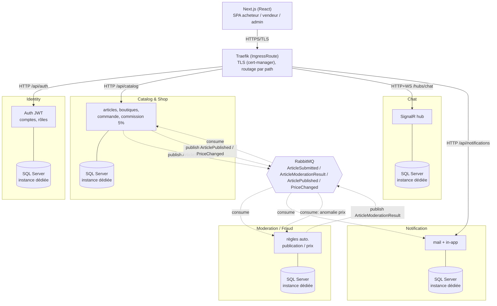
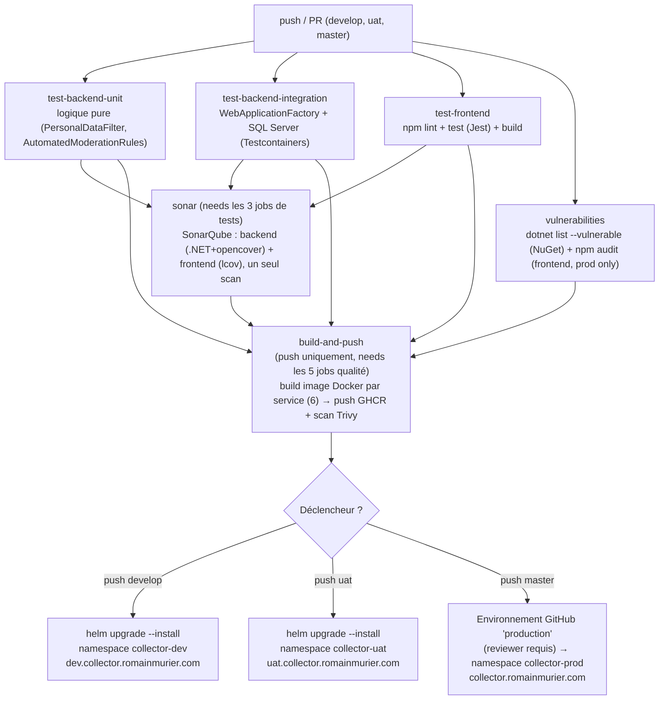

# Collector.shop — Bloc "Superviser et assurer le développement des applications logicielles"

> README de pilotage de projet. Il centralise les consignes, le contexte métier, les décisions
> d'architecture déjà actées, et surtout les **questions encore ouvertes**. À relire/mettre à jour
> à chaque session de travail — c'est la source de vérité pour tous les prompts futurs sur ce repo.

- **Évaluation** : Bloc individuel *Superviser et assurer le développement des applications logicielles* (CESI, INFMAALSIA2V)
- **Rôle joué** : Lead Developer chez Collector (start-up fictive)
- **Format de rendu** : Soutenance orale 20 min + 15 min d'échange, devant un public "spécialiste du développement" (pas de vulgarisation)
- **Échéance cible** : soutenance dans **~1 à 2 mois** à partir du 2026-10-11 (date exacte non fixée — voir [Questions ouvertes](#questions-ouvertes))
- **Documents sources** (à la racine du repo, ne pas modifier) :
  - `Consignes eval bloc Superviser et Assurer Développment.pdf`
  - `contexte_Collector.pdf`
  - `Grille_eval_bloc_INFMAALSIA2V_Superviser_dev_apps_logicielles.xlsx`

---

## 1. Contexte métier (résumé)

**Collector** est une start-up française (5 ans d'existence), historiquement événementielle (salons
d'objets de collection "du quotidien" : baskets éditions limitées, posters dédicacés, figurines,
cassettes V2000...), qui vient de lever des fonds en crowdfunding pour lancer **Collector.shop**,
une marketplace web de vente d'objets de collection **entre particuliers**.

- Commission de **5 %** prélevée par Collector sur chaque transaction.
- Équipe IT toute récente : 1 Lead Dev (= moi dans l'exercice), 2 dev confirmé·e·s (5 ans d'XP).
  Embauches futures possibles, pas de contrainte budget/RH dans l'exercice (mais rester réaliste,
  pas de "mouton à 5 pattes").
- SI existant limité : Office 365 Business Standard, Power BI, Exchange, Adobe CC, laptops Windows 11,
  1 Mac (design), site vitrine WordPress hébergé en France. **Rien d'existant côté app** — tout est à
  construire.

### Rôles utilisateurs

| Rôle | Capacités |
|---|---|
| **Visiteur** (non authentifié) | Parcours du catalogue uniquement |
| **Acheteur** | Inscription obligatoire pour acheter. Espace dédié (achats en cours, historique, notifications, chat). Recommandations selon centres d'intérêt paramétrables. |
| **Vendeur** | Inscription obligatoire pour vendre. Peut aussi être acheteur. Peut créer **plusieurs boutiques virtuelles**, doit être identifié comme vendeur particulier. Espace dédié (ventes en cours, historique, notifications, chat). |
| **Admin** | Back-office : gestion des catégories (lui seul peut en créer), suppression d'articles/vendeurs hors charte, modération du chat. |

### Règles métier clés

- Chat acheteur ↔ vendeur accessible depuis les espaces dédiés ; modération possible par l'admin.
- Paiement **uniquement via la plateforme** (carte bancaire pour la v1) — les échanges d'infos
  personnelles (email, téléphone) entre acheteur/vendeur doivent être **techniquement empêchés**
  (anti-contournement du paiement).
- Chaque article : photos + description + prix + frais de port. **Contrôle avant mise en ligne**,
  à automatiser au maximum (le moins d'intervention humaine possible).
- Changement de prix → (1) notifier les acheteurs intéressés, (2) notifier un composant back-office
  anti-fraude.
- La direction veut pouvoir **brancher** un outil de détection de fraude/anomalie (prix suspect,
  vendeur suspect) — build vs buy non tranché, l'architecture doit juste le permettre.
- Notifications : nouvel article, article correspondant à un centre d'intérêt — paramétrables,
  visibles dans l'espace perso + envoyées par email.
- Contraintes transverses : **internationalisation**, **accessibilité**, **sécurité de premier plan**
  (transactions financières), **architecture évolutive** (facilité d'ajout de features : enchères,
  live shopping, bot avant-vente, analytics direction...).
- Le sujet est fictif : on peut enrichir/ajouter des exigences tant que c'est cohérent avec le métier.

---

## 2. Travail demandé (consignes officielles)

La mission se déroule en **3 phases**, toutes à restituer en soutenance :

1. **Structuration du processus de développement**
   - 4 indicateurs/métriques de qualité logicielle (appui possible sur **ISO 25010**), avec
     justification de leur rôle anti-dette-technique.
   - Cycle de vie du développement intégrant une démarche **DevSecOps** (mesures de sécurité par
     étape clé), schéma détaillé du pipeline **CI/CD**, tests automatisés intégrés (types + outils),
     lien explicite entre ces outils et les indicateurs qualité.
   - Cartographie des compétences nécessaires au projet + proposition d'une action de formation
     réaliste.
2. **Développement et déploiement (réalisation du POC)**
   - Reformulation des exigences fonctionnelles de **la** fonctionnalité métier retenue, sous forme
     de **backlog** (user stories + critères d'acceptation).
   - Schéma d'architecture technique (sécurité incluse : BDD, protocole de comm, framework...).
   - **Expérimentation** documentée d'une techno/plateforme critique (pas un simple test de langage
     ou de communication front/back) — protocole, environnement de test, étapes de reproduction,
     difficultés, limites, résultats justifiant l'adoption (ou le rejet).
   - Développement du prototype : au moins **une fonctionnalité métier** fonctionnelle, démontrée par
     tests d'appel/acceptation (réutilisables comme 2 des tests minimum du pipeline CI/CD). Respect
     de l'architecture définie, intégration d'une solution de sécurité (HTTPS/TLS, auth/autorisation,
     scan de vulnérabilités), d'une composante d'observabilité (logs centralisés, métriques ou
     tracing), pipeline CI/CD avec **au minimum 2 types de tests**.
   - Démonstration en soutenance de la **montée en charge** (Siege/JMeter ou équivalent) — pas
     obligatoirement dans le pipeline CI/CD.
3. **Plan de remédiation (analyse sécurité)**
   - Analyse des résultats de tests et métriques collectées (dont les tests de charge).
   - Identification des vulnérabilités potentielles.
   - Plan de remédiation priorisé et justifié, adapté au contexte Collector.

### Conseils pris en compte
- Vocabulaire précis exigé (pas d'approximation côté jury technique).
- Schémas lisibles et complets (pas de notation sur la forme "PowerPoint").
- Démo du prototype à préparer pour éviter l'effet démo raté → prévoir une **vidéo de secours**.

---

## 3. Grille d'évaluation (10 critères, barème A/B/C/D)

Chaque critère est noté 5/4/2/1 pt. Moyenne convertie en lettre : **A ≥ 4,6**, **B ≥ 3,6**, **C ≥ 1,6**, **D < 1,6**.

| # | Critère | Ce qui est attendu pour le niveau max (5 pts) |
|---|---|---|
| 1 | Fiabilité du protocole d'expérimentation | Protocole complet (techs, interactions), difficultés + résultats présentés, justifie l'adoption |
| 2 | Qualité technique du prototype | POC valide les points clés d'architecture (découpage, comm. inter-services, sécurité, hébergement, orchestration), bien documenté |
| 3 | Démonstration de fonctionnalité métier | La feature répond au besoin exprimé par la MOA |
| 4 | Conformité du processus CI/CD | Pipeline schématisé + conforme, POC intègre la plateforme CI/CD en cohérence avec le schéma |
| 5 | Environnement d'exécution / déploiement | POC exécuté dans un **environnement managé**, disponibilité + montée en charge démontrées |
| 6 | Indicateurs de qualité logicielle | ≥ 4 indicateurs, servent des objectifs qualité, mesurés, mettent en évidence des axes anti-dette-technique |
| 7 | Conformité du processus de test | Process formalisé (types, outils, parties prenantes), ≥ 2 types de tests appliqués et **réussis** |
| 8 | Remédiation sécurité | Plan priorisé sur les risques critiques, ≥ 2 bonnes pratiques de sécu **intégrées au POC** |
| 9 | Gestion des compétences équipe | Compétences recensées, expertises à acquérir identifiées, ≥ 1 action de formation concrète |
| 10 | Qualité de la présentation | Schémas lisibles, démo préparée, discours fluide/structuré, vocabulaire précis |

**Point d'attention critère 5** : il faut un **environnement managé** (pas juste "ça tourne en local
sur mon poste") → conforte le choix K3s sur OVH plutôt qu'un simple `docker-compose` local.

**Point d'attention critère 8** : au minimum 2 bonnes pratiques de sécurité doivent être **dans le
POC lui-même**, pas seulement sur le papier (ex: HTTPS/TLS + JWT, ou JWT + scan de vulnérabilités).

---

## 4. Décisions d'architecture actées

> Journal daté. Toute décision ici a été validée explicitement par l'utilisateur. Ne pas la remettre
> en cause sans repasser par une question.

| Sujet | Décision | Date | Justification |
|---|---|---|---|
| Langage backend | **C# / .NET uniquement**, microservices | 2026-10-11 | Confort du dev, cohérence stack, pas de dispersion polyglotte finalement (Python envisagé puis écarté) |
| Frontend | **Next.js (React)**, SPA assez complet | 2026-10-11 | Demandé explicitement, parcours complet démontrable en soutenance |
| Base de données | **SQL Server uniquement**, **une instance SQL Server distincte par service** (pas juste une base/schéma sur une instance partagée) | 2026-10-11 | Découplage microservices maximal (valorisé au critère grille #2), isolation totale des pannes/ressources entre services, pas de persistance polyglotte |
| Authentification | **JWT maison** (pas Keycloak) | 2026-10-11 | Choix utilisateur — à documenter comme solution de sécurité minimale (critère grille #8) |
| Message broker | **RabbitMQ** | 2026-10-11 | Sert de "techno d'expérimentation" documentée (phase 1.2.2), events : article publié, prix changé, alerte fraude |
| CI/CD | **GitHub + GitHub Actions** | 2026-10-11 | Intégration simple, registre d'images GHCR, Dependabot/CodeQL dispo |
| Qualité de code | **SonarQube auto-hébergé** (serveur déjà existant côté utilisateur) | 2026-10-11 | Déjà en place, pas de nouvel outil à opérer |
| Orchestration | **K3s sur un serveur OVH déjà provisionné** | 2026-10-11 | Remplit l'exigence "environnement managé" du critère #5 |
| Entrée réseau / Gateway | **Traefik** (fourni nativement par k3s), **pas de gateway applicatif custom** (YARP abandonné) | 2026-10-11 | Traefik déjà présent sur le serveur OVH — routage HTTP/HTTPS direct vers chaque service K8s (IngressRoute), chaque service valide son propre JWT. Moins de code à maintenir pour un solo dev |
| Environnements | **3 environnements : dev, uat, prod**, chacun un namespace K8s dédié (`collector-dev`, `collector-uat`, `collector-prod`) | 2026-10-11 | Un seul chart Helm, une valeur par environnement — déployable sans changement de template |
| Secrets | **Infisical**, synchronisé vers K8s via l'Infisical Secrets Operator | 2026-10-11 | Demandé explicitement par l'utilisateur |
| Version .NET | **.NET 10 (LTS)** | 2026-10-11 | Dernière LTS disponible à la date du projet |
| Observabilité (logs) | **Omnia** (outil propriétaire de l'utilisateur, omnia-monitoring.com) | 2026-10-11 | À intégrer — détails d'intégration à préciser (voir questions ouvertes) |
| Observabilité (métriques) | **Prometheus + Grafana**, en complément d'Omnia si besoin | 2026-10-11 | Standard K8s, dashboards de charge utiles en soutenance |
| Load testing | Siege ou JMeter (cité dans les consignes) | — | Outil précis non tranché, voir questions ouvertes |
| Stratégie de branches | **`develop`→dev, `uat`→uat, `master`→prod** (push direct, pas de tags), déploiement prod protégé par l'environnement GitHub "production" (reviewer requis) | 2026-10-14 | Le repo utilise `master` comme branche par défaut (pas `main`) — alignement du pipeline CD sur les branches réelles, schéma tag-based abandonné pour rester simple en solo dev |
| Nom de domaine | **romainmurier.com** : `dev.collector.romainmurier.com` (dev), `uat.collector.romainmurier.com` (uat), `collector.romainmurier.com` (prod) | 2026-10-14 | Domaine personnel de l'utilisateur, déjà configurable (DNS + cert-manager/Let's Encrypt) |
| Séparation des secrets | **GitHub** (secrets de **repo**, une seule valeur de chaque) = secrets d'infra CI/CD : `KUBE_CONFIG_B64`, `INFISICAL_CLIENT_ID`/`INFISICAL_CLIENT_SECRET`, `SONAR_HOST_URL`/`SONAR_TOKEN`. **Infisical** = secrets applicatifs uniquement, jamais lus par la CI — synchronisés en continu vers K8s par l'Infisical Secrets Operator (`resyncInterval: 60`), dont le Secret d'auth (`infisical-machine-identity`) est lui-même reprovisionné à chaque déploiement via `--set` depuis les GitHub Secrets ci-dessus | 2026-10-15 | Les 3 environnements tournent sur le **même cluster OVH physique** : ce sont des valeurs identiques pour dev/uat/prod, donc secret de repo (pas de secret d'environnement — le job `deploy-prod` est déjà bloqué par l'approbation reviewer via `environment: production`, dupliquer la valeur n'ajoutait aucune barrière réelle en plus). Objectif annexe : changer de serveur (nouveau `KUBE_CONFIG_B64`) ne doit demander aucune étape manuelle côté Infisical — satisfait en faisant provisionner `infisical-machine-identity` par le chart lui-même |
| Mot de passe SQL Server par service | `MSSQL_SA_PASSWORD__<service>` : **une valeur `sa` distincte par service** (5 clés Infisical, pas 1 partagée) | 2026-10-16 | Avoir 5 instances SQL Server isolées mais un seul mot de passe `sa` partagé entre elles annulait une partie du bénéfice de l'isolation (critère grille #2) : une connection string qui fuite donnait accès `sa` aux 4 autres bases. Le mot de passe varie aussi naturellement par environnement puisque dev/staging/prod sont des scopes Infisical séparés |

---

## 5. Architecture technique proposée

Découpage **microservices C#**, exposés directement par **Traefik** (fourni nativement par k3s —
pas de gateway applicatif custom à maintenir), communiquant en synchrone (HTTP/REST, DNS K8s natif)
pour les requêtes utilisateur et en asynchrone (RabbitMQ, aussi via DNS K8s) pour les événements
métier. Chaque service possède sa **propre instance SQL Server** (StatefulSet K8s dédié), et non une
base partagée sur une instance commune — isolation complète au prix d'une consommation ressources
plus élevée sur le cluster OVH (voir note de dimensionnement en section 12).



- Traits pleins = appels HTTP/WebSocket (Traefik route directement vers le `Service` K8s de chaque
  microservice — pas de passage applicatif intermédiaire).
- Traits pointillés = événements asynchrones via RabbitMQ, atteint lui aussi en DNS K8s natif
  (`collector-rabbitmq`). Moderation n'est pas exposé par Traefik : il ne communique que par RabbitMQ.

### Services (tous ASP.NET Core / C#)

1. **Identity** (`src/services/Identity/Identity.Api`) — comptes acheteur/vendeur/admin, rôles,
   `POST /auth/register`, `POST /auth/login` (émission JWT), `POST /auth/become-seller`. Tout compte
   est acheteur par défaut, le switch de rôle acheteur ↔ vendeur se fait via ce dernier endpoint.
2. **Catalog & Shop** (`src/services/Catalog/Catalog.Api`) — boutiques virtuelles (1 vendeur → N
   boutiques), articles (`POST /shops`, `POST /shops/{id}/articles`, `GET /articles` catalogue public,
   `PUT /articles/{id}/price`), publication des événements `ArticleSubmittedEvent` / `ArticlePublishedEvent`
   / `PriceChangedEvent`, consomme `ArticleModerationResultEvent` pour faire passer l'article en ligne.
3. **Chat** (`src/services/Chat/Chat.Api`) — `ChatHub` SignalR (`/hubs/chat`, JWT via query string
   `access_token`), historique persistant, **filtrage automatique email/téléphone** dans les messages
   (anti-contournement du paiement, `PersonalDataFilter`).
4. **Notification** (`src/services/Notification/Notification.Api`) — `POST /subscriptions` (centres
   d'intérêt acheteur), consomme `ArticlePublishedEvent` et notifie (in-app + email stub via
   `IEmailSender`, fournisseur SMTP réel à brancher plus tard) les acheteurs dont un mot-clé matche.
5. **Moderation/Fraud** (`src/services/Moderation/Moderation.Api`) — consomme `ArticleSubmittedEvent`
   (règles auto. : prix/description/titre) et publie `ArticleModerationResultEvent` ; consomme aussi
   `PriceChangedEvent` pour flaguer les variations de prix suspectes (> 50 %). Trace d'audit persistée
   (`ModerationDecision`) ; point d'extension pour un futur outil de détection de fraude externe
   (build/buy non tranché par la direction).
6. **Frontend** (`src/frontend/web`) — Next.js (App Router), `output: "standalone"` pour l'image Docker.

**Traefik** n'est pas un service applicatif du repo : c'est l'ingress déjà présent sur le cluster k3s
OVH, configuré via les `IngressRoute`/`Middleware` du chart Helm (`infra/helm/collector`).

**Fil rouge "fonctionnalité métier"** (critère grille #3) : *publication d'un article avec contrôle
automatisé avant mise en ligne* — couvre Catalog (soumission), Moderation (règles auto.), Notification
(alerte aux acheteurs intéressés), et traverse RabbitMQ + 3 instances SQL Server distinctes. Bon
candidat pour la démo car il active plusieurs services en une seule action utilisateur.

### MVP par phases (réalisme solo dev, ~1-2 mois)

- **Phase A — Socle** : Identity + Catalog/Shop (CRUD boutiques/articles + catalogue) + Frontend
  Next.js (parcours visiteur → inscription → publication article → achat simplifié) + pipeline
  CI/CD de base (build, tests unitaires, SonarQube, image Docker, déploiement dev sur K3s).
- **Phase B — Différenciation** : RabbitMQ + événements, Chat SignalR, Notification service (mail +
  in-app), déploiement uat sur K3s, observabilité (Omnia + Prometheus/Grafana).
- **Phase C — Sécurité & qualité** : Moderation/Fraud (règles auto.), scan de vulnérabilités dans le
  pipeline, tests de charge (Siege/JMeter), plan de remédiation, durcissement sécurité (HTTPS/TLS
  partout, policies K8s, secrets via Infisical).

> Objectif : à chaque fin de phase, le POC est démontrable de bout en bout — évite l'écueil "tout est
> à moitié fait" à l'approche de la soutenance.

---

## 6. Stratégie de tests

| Niveau | Outils (C#) | Outils (frontend) | Cible |
|---|---|---|---|
| Unitaire | xUnit + FluentAssertions + Moq/NSubstitute | Jest / React Testing Library | Logique métier isolée (règles commission, règles modération, validation backlog) |
| Intégration | xUnit + `WebApplicationFactory` + Testcontainers (SQL Server) | — | Endpoints API avec vraie base (éphémère), interactions RabbitMQ |
| Acceptation | xUnit (ou SpecFlow si BDD souhaité) sur les critères d'acceptation du backlog | Playwright/Cypress (optionnel) | Fonctionnalité métier retenue — réutilisable comme test(s) obligatoire(s) du pipeline |
| Charge | Siege ou JMeter (à trancher) | — | Démonstration montée en charge en soutenance |
| Qualité statique | SonarQube (analyse C#) | SonarQube (analyse JS/TS) | Dette technique, code smells, couverture |
| Sécurité | `dotnet list package --vulnerable`, Trivy (scan image Docker) | `npm audit` | Scan de vulnérabilités (exigence consignes) |

Le pipeline CI/CD doit intégrer **au minimum 2 types de tests** parmi unitaire/intégration/acceptation
— viser unitaire + intégration dès la Phase A, ajouter l'acceptation en Phase B/C.

---

## 7. Pipeline CI/CD (GitHub Actions — implémenté dans `.github/workflows/`)

Un seul workflow, `pipeline.yml`, découpé en **jobs séparés par type d'étape** (plus lisible qu'un
seul gros job "qualité", et surtout plus proche du schéma attendu par les consignes) :
`test-backend-unit`, `test-backend-integration`, `test-frontend` et `vulnerabilities` tournent en
parallèle (aucune dépendance entre eux) — unitaires et intégration sont volontairement deux jobs
distincts (filtrés via `--filter "Category=Unit"` / `"Category=Integration"`, classes marquées
`[Trait("Category", ...)]`) pour voir immédiatement, dans l'UI GitHub Actions, lequel des deux types
échoue. `sonar` dépend des trois jobs de tests (backend unitaires + intégration + frontend —
inutile de lancer l'analyse si les tests de base échouent déjà) et réexécute son propre cycle
build/test côté .NET **et** côté frontend (Jest avec couverture, `sonar.javascript.lcov.reportPaths`)
— redondant en apparence, mais requis : le scanner Sonar doit encadrer la compilation/les tests
elle-même (`sonarscanner begin`/`end`), impossible de le brancher après coup sur un build déjà fait
ailleurs. Une seule analyse Sonar couvre donc backend **et** frontend (pas deux projets séparés).
`build-and-push` exige (`needs:`) que les **cinq** jobs de qualité aient réussi : un test ou un scan
en échec bloque tout déploiement, pas juste un warning affiché à côté. Tous les jobs de qualité
tournent sur PR et push ; `build-and-push` et les 3 déploiements ne tournent que sur push (jamais
sur une PR).



**Séparation stricte des deux magasins de secrets** (décision 2026-10-15, voir section 4) :
- **GitHub** (Secrets de **repo** — une seule valeur de chaque, les 3 environnements tournant sur
  le même cluster physique) : uniquement des secrets d'**infra CI/CD** — `KUBE_CONFIG_B64` (accès
  au cluster OVH), `INFISICAL_CLIENT_ID`/`INFISICAL_CLIENT_SECRET` (clientId/clientSecret de la
  Machine Identity Infisical), `SONAR_HOST_URL`/`SONAR_TOKEN`. Le pipeline ne lit **jamais** de
  secret applicatif depuis Infisical : il décode `KUBE_CONFIG_B64` pour parler au cluster, et passe
  `INFISICAL_CLIENT_ID`/`SECRET` à Helm via `--set-string` pour (re)créer le Secret K8s
  `infisical-machine-identity` à chaque déploiement (`templates/infisical-machine-identity.yaml`)
  — c'est tout ce dont l'opérateur Infisical a besoin pour s'authentifier lui-même ensuite.
- **Infisical** : uniquement des secrets **applicatifs** (`Jwt__SigningKey`, `ConnectionStrings__*`,
  5× `MSSQL_SA_PASSWORD__<service>` — un mot de passe `sa` **distinct par service**, pas une valeur
  partagée entre les 5 instances SQL Server, voir section 4 —, `RabbitMq__UserName`/`Password`).
  Ils ne transitent **jamais** par ce
  pipeline — l'Infisical Secrets Operator, installé une fois au niveau cluster, les synchronise lui
  même en continu depuis Infisical vers le Secret K8s de chaque namespace
  (`resyncInterval: 60`, `templates/infisical-secret.yaml`) : changer une valeur dans Infisical la
  propage automatiquement en ~60s, sans passer par la CI.

**Automatisation du changement de serveur** : si le cluster OVH change un jour, seul
`KUBE_CONFIG_B64` doit être mis à jour dans GitHub Secrets — le prochain push redéploie et
reprovisionne automatiquement `infisical-machine-identity` dans les 3 namespaces (plus de
`kubectl create secret` manuel). Seuls les prérequis vraiment cluster-level (Traefik, cert-manager,
l'opérateur Infisical lui-même) restent une installation manuelle unique sur le nouveau cluster,
voir `infra/helm/collector/README.md`.

---

## 8. Sécurité (DevSecOps)

- **HTTPS/TLS** de bout en bout : cert-manager + Let's Encrypt sur l'Ingress K3s (nécessite un nom de
  domaine — voir questions ouvertes).
- **AuthN/AuthZ** : JWT maison émis par Identity, **vérifié indépendamment par chaque service**
  (Traefik ne fait que TLS + routage, pas de validation JWT centralisée — évite un point de défaillance
  unique) + policies par rôle (acheteur/vendeur/admin).
- **Secrets** : Infisical (pas de secret en clair dans le repo ni dans les manifests K8s — injection
  via opérateur Infisical ou init-container).
- **Scan de vulnérabilités** : dépendances (NuGet/npm audit) + images Docker (Trivy) dans le pipeline.
- **Anti-contournement paiement** : filtrage/masquage des patterns email/téléphone dans le chat —
  **implémenté** (`Chat.Api/Domain/PersonalDataFilter.cs`, regex appliquée dans `ChatHub.SendMessage`).
- **DevSecOps par étape du cycle de vie** (à détailler en phase 1 des consignes) :
  - Dev → SAST/lint pré-commit, revue de code
  - Build → scan dépendances + image
  - Test → tests sécurité (authZ, injection) en intégration
  - Déploiement → secrets via Infisical, TLS, policies réseau K8s (NetworkPolicy)
  - Run → observabilité (Omnia/Prometheus) pour détection d'anomalies, plan de remédiation (phase 3)

---

## 9. Indicateurs de qualité logicielle (brouillon — ISO 25010)

> **À valider/affiner** — 4 indicateurs minimum exigés par les consignes, chacun doit être mesuré et
> justifié vis-à-vis de la dette technique.

1. **Couverture de tests (%)** → *Fiabilité / Maintenabilité* — mesurée par SonarQube, seuil cible à
   définir (ex: 70 % sur la logique métier).
2. **Dette technique (ratio SonarQube / code smells bloquants)** → *Maintenabilité* — suivi dans le
   temps pour éviter l'accumulation.
3. **Taux de vulnérabilités détectées (dépendances + images) non résolues** → *Sécurité* — suivi par
   le scan CI, objectif zéro vulnérabilité critique/haute en prod.
4. **Temps de réponse p95 sous charge** → *Performance/Efficacité* — mesuré via les tests de charge
   (Siege/JMeter) + Prometheus, seuil cible à définir selon le volume simulé.

---

## 10. Structure de dossiers (scaffoldée le 2026-10-11)

```
/
├── README.md
├── global.json                     ← pin SDK .NET 10
├── docker-compose.yml              ← confort dev LOCAL uniquement (SQL Server x5 + RabbitMQ)
├── src/
│   ├── Collector.sln
│   ├── Directory.Build.props       ← TargetFramework net10.0, Nullable, InvariantGlobalization=false
│   ├── shared/
│   │   ├── Collector.Contracts/    ← DTOs d'événements RabbitMQ (ArticleSubmittedEvent, ...)
│   │   └── Collector.Messaging/    ← IEventBus/RabbitMqEventBus + RabbitMqConsumer<T> générique
│   ├── services/
│   │   ├── Identity/Identity.Api/      ← comptes, JWT (xUnit à ajouter : tests non encore écrits)
│   │   ├── Catalog/Catalog.Api/        ← boutiques, articles, publication d'événements
│   │   ├── Chat/Chat.Api/              ← SignalR + filtrage anti-contournement
│   │   ├── Notification/Notification.Api/ ← abonnements + emails stub
│   │   └── Moderation/Moderation.Api/  ← règles auto. + audit trail
│   │       (chaque *.Api/ contient : Dockerfile, appsettings.json, appsettings.Development.json)
│   └── frontend/web/                ← Next.js (App Router, TypeScript, Tailwind), Dockerfile
│       └── src/app/                 ← catalogue, login/register, compte, boutiques/[id], articles/[id],
│                                        notifications — cf. section 10.1
├── infra/helm/collector/
│   ├── Chart.yaml, values.yaml, values-dev.yaml, values-uat.yaml, values-prod.yaml
│   ├── README.md                   ← prérequis cluster + clés Infisical attendues
│   └── templates/                  ← services.yaml (Deployment+Service en boucle), sqlserver/,
│                                      rabbitmq.yaml, ingressroute.yaml, infisical-secret.yaml, configmap.yaml
├── load-tests/                     ← vide, scripts Siege/JMeter à ajouter (Phase C)
└── .github/workflows/
    └── pipeline.yml                ← build/test/Sonar (.NET) + lint/build (frontend) -> build+push
                                        6 images GHCR, scan Trivy -> déploiement dev/uat/prod (bloqué
                                        si backend ou frontend échoue, voir section 7)
```

**Ce qui est réellement fonctionnel aujourd'hui** : SDK .NET 10.0.100 installé en local
(`~/.dotnet`, conforme au pin `global.json`) et **build réel vérifié** — `dotnet build
src/Collector.sln` passe avec 0 warning / 0 erreur sur les 12 projets (5 services + tests + 3 libs
partagées). Les **tests unitaires purs** (sans dépendance externe) passent : 6/6
`Chat.Api.Tests.PersonalDataFilterTests` + 4/4 `Moderation.Api.Tests.AutomatedModerationRulesTests`.
Le frontend Next.js a été généré et **buildé avec succès** (`npm run build` + `npm run lint`
passés), le chart Helm a été **validé** (`helm lint` + `helm template` sur les 3 environnements,
zéro erreur).

**Ce qui n'est PAS encore fait / bloqué dans cette session** : les tests d'**intégration**
(Testcontainers → SQL Server éphémère) échouent avec `DockerUnavailableException` : le CLI `docker`
est présent sur l'hôte Windows (Docker Desktop) mais **l'intégration WSL n'est pas activée** pour
cette distro (`/mnt/wsl/docker-desktop` existe mais pas de socket exposé ici) — réglage à faire côté
utilisateur dans *Docker Desktop → Settings → Resources → WSL Integration*, pas quelque chose
d'automatisable depuis ce terminal. Tant que ce n'est pas activé : aucune image Docker
construite/testée, et les suites `AuthEndpointsTests` (Identity), `ShopAndArticleEndpointsTests`
(Catalog), `ConversationEndpointsTests` (Chat), `SubscriptionAndNotificationEndpointsTests`
(Notification) et `DecisionsEndpointTests` (Moderation) restent non exécutables ici. Pas de
documents/dossiers déplacés (les 3 PDF/XLSX consignes restent à la racine).

---

## 10.1 Frontend Next.js — parcours implémenté (2026-10-13)

> Le squelette `create-next-app` par défaut a été remplacé par le vrai parcours métier, câblé sur
> les API réellement exposées par Identity/Catalog/Notification (voir section 5). Le parcours
> **achat** n'est pas implémenté côté frontend car **aucun endpoint de commande/paiement n'existe
> encore côté Catalog.Api** — plutôt que de simuler un faux achat, le fil rouge démontré est celui
> retenu en section 5 : publication d'article → contrôle automatisé → notification. Le **chat
> SignalR** n'a pas non plus de page dédiée pour l'instant (service fonctionnel côté backend,
> intégration frontend non prioritaire sur ce increment).

- `/` — catalogue public (visiteur, `GET /articles`, articles `Published` uniquement).
- `/articles/[id]` — détail d'un article + statut de modération.
- `/login`, `/register` — Identity (`/auth/login`, `/auth/register`), JWT stocké côté client
  (`localStorage`, décodé pour en extraire `sub`/`email`/`display_name` — les rôles viennent
  directement de la réponse API, jamais décodés depuis le token).
- `/compte` — tableau de bord : bouton "Devenir vendeur" (`/auth/become-seller`), création de
  boutique (`POST /shops`), liste des boutiques du vendeur (voir limite ci-dessous).
- `/boutiques/[shopId]` — détail boutique + formulaire de publication d'article
  (`POST /shops/{id}/articles`), **polling 3 s** sur `GET /shops/{id}` pour visualiser en direct la
  transition `PendingReview → Published/Rejected` pilotée par Moderation via RabbitMQ.
- `/notifications` — abonnement à un centre d'intérêt (`POST /subscriptions`) + liste des
  notifications in-app (`GET /notifications/{userId}`, `POST /notifications/{id}/read`).

**Limite connue assumée** : `Catalog.Api` n'expose aucun endpoint "boutiques d'un vendeur" — la
liste des boutiques sur `/compte` est donc reconstituée **côté client** (`localStorage`, par
utilisateur) au moment de la création. Une boutique créée sur un autre navigateur/appareil reste
accessible via son URL directe mais n'apparaît pas automatiquement dans cette liste. À corriger en
ajoutant un vrai `GET /shops?sellerId=` si ce point est jugé bloquant pour la démo.

**Glue backend indispensable ajoutée pour que le frontend fonctionne en local** (Identity, Catalog,
Notification uniquement — Chat/Moderation non appelés par le frontend pour l'instant) :
- CORS (`Cors:FrontendOrigin`, nouvelle clé de config — valeur dev `http://localhost:3000` dans
  `appsettings.Development.json` de chaque service ; **à définir via Helm/Infisical pour
  uat/prod une fois le nom de domaine du frontend connu**, voir questions ouvertes).
- `Properties/launchSettings.json` sur les 5 services (`dotnet run` sans Docker) pour leur donner un
  port HTTP fixe et pouvoir tous les lancer simultanément en local : Identity `5101`, Catalog
  `5102`, Chat `5103`, Notification `5104`, Moderation `5105`.

**Pour lancer le parcours complet en local** : démarrer `docker-compose up` (SQL Server x5 +
RabbitMQ), puis `dotnet run` dans chacun des 5 `src/services/*/*.Api/`, puis côté frontend copier
`src/frontend/web/.env.local.example` en `.env.local` et lancer `npm run dev` dans
`src/frontend/web/`.

**Tests Jest (2026-10-14)** : config `next/jest` câblée (`jest.config.js`, `jest.setup.ts`,
script `npm test`), **5 suites / 12 tests, tous verts** — logique pure (`decodeJwt`,
`articleStatusLabel`, `known-shops`) + rendu de composants (`StatusBadge`, `ArticleCard`) avec
React Testing Library. Intégré à `pipeline.yml` (`npm test -- --ci`, avant le build). Avec les suites
unitaires C# déjà vertes (`Chat.Api.Tests`, `Moderation.Api.Tests`), ça couvre dès maintenant le
minimum de 2 types de tests du critère #7 **sans dépendre du déblocage Docker/WSL** — les tests
d'intégration xUnit/Testcontainers restent un 3ᵉ type à activer une fois ce blocage levé (section
12).

---

## 11. Bonnes pratiques à respecter

- Pas de secret en clair dans le repo (ni `.env` commité) — tout via Infisical.
- 1 **instance SQL Server dédiée par service** (pas d'instance partagée) — pas d'accès direct
  cross-service à la base d'un autre service (passer par son API ou par un événement RabbitMQ).
- Conventions de commit et de nommage de branches à définir (voir questions ouvertes).
- Chaque service doit être démontrable/déployable indépendamment (image Docker + manifeste K8s dédié).
- Documenter chaque expérimentation technologique (protocole, environnement, résultats) au fil de
  l'eau plutôt qu'a posteriori — c'est noté explicitement (critère grille #1).
- Tous les Dockerfiles des services .NET attendent un **contexte de build = racine du repo** (pas le
  dossier du service), car ils doivent copier `global.json`, `src/Directory.Build.props` et les
  projets `src/shared/*` référencés. Toujours builder avec `-f src/services/<X>/<X>.Api/Dockerfile .`
  depuis la racine, jamais depuis le dossier du service.
- EF Core utilise `Database.EnsureCreated()` au démarrage (pas de migrations formelles) — cohérent
  avec la consigne "rester au niveau du prototypage", mais à remplacer par de vraies migrations
  (`dotnet ef migrations add`) avant tout usage au-delà de la démo.
- Code applicatif **sans branchement conditionnel par environnement** : tout ce qui change entre
  dev/uat/prod vient de variables d'environnement (ConfigMap + Secret K8s), jamais d'un `if (env ==
  "prod")` dans le code C#/TS.

---

## 12. Questions ouvertes

> Toutes les questions ci-dessous doivent être tranchées avant ou pendant l'implémentation. Si une
> question est résolue en session, **déplacer la décision dans la section 4** et cocher ici.

### Priorité haute (bloquantes pour un vrai déploiement)
- [ ] **Accès au cluster OVH** : récupération du kubeconfig, encodage en base64, dépôt en secret de
      **repo** GitHub sous la clé `KUBE_CONFIG_B64` — voir `infra/helm/collector/README.md`.
      **Point d'attention dimensionnement** : 5 instances SQL Server + RabbitMQ par environnement
      (×3 environnements = 15 StatefulSets SQL Server au total) — chaque instance consomme
      typiquement ≥ 2 Go de RAM même en édition Developer. Vérifier que le serveur OVH a la capacité ;
      sinon réduire à un seul environnement actif à la fois ou mutualiser certaines instances.
- [ ] **SonarQube auto-hébergé** : URL du serveur (`SONAR_HOST_URL`) + token (`SONAR_TOKEN`) à ajouter
      en GitHub Secrets, et vérifier que les runners GitHub-hosted (IP publiques) peuvent l'atteindre
      (sinon prévoir un runner self-hosted ou ouvrir le firewall OVH).
- [ ] **Infisical, environnements du projet** : confirmer que les 3 environnements sont bien créés
      avec les clés listées dans `infra/helm/collector/README.md` (note : `values-uat.yaml` pointe
      déjà vers `environmentSlug: staging` — le projet Infisical de l'utilisateur utilise les noms
      par défaut dev/staging/prod plutôt que dev/uat/prod, à garder cohérent).
- [ ] **Infisical Secrets Operator + cert-manager** : confirmer qu'ils seront installés au niveau
      cluster (prérequis documentés dans `infra/helm/collector/README.md`, hors scope du chart lui-même).
- [ ] **Propriétaire GitHub réel** : remplacer `CHANGE_ME` dans `global.imageRegistry` (values*.yaml)
      par `ghcr.io/<org-ou-user-github-réel>` une fois le repo créé sur GitHub.
- [ ] **Environnement GitHub "production"** : à configurer manuellement dans Settings > Environments
      avec reviewers requis (protection utilisée par `deploy-prod` dans `pipeline.yml`, non automatisable).
- [ ] **SQL Server en prod** : édition Developer non licenciée pour la production (cf. commentaire dans
      `values-prod.yaml`) — décider entre licence Standard/Enterprise payante ou bascule vers une offre
      managée (Azure SQL) avant un vrai déploiement prod.
- [ ] **DNS romainmurier.com** : créer les enregistrements `dev.collector`, `uat.collector` et
      `collector` (A ou CNAME) pointant vers l'IP publique du serveur OVH/k3s, sinon cert-manager
      ne pourra pas valider les certificats Let's Encrypt (challenge HTTP-01/DNS-01) pour les 3
      domaines ajoutés en section 4.
- [ ] **CORS frontend** (`Cors:FrontendOrigin`) : à définir via Helm/Infisical pour uat/prod
      maintenant que le nom de domaine est connu (`https://dev.collector.romainmurier.com`,
      `https://uat.collector.romainmurier.com`, `https://collector.romainmurier.com`) — actuellement
      seule la valeur dev locale (`http://localhost:3000`) est câblée dans
      `appsettings.Development.json` de chaque service (voir section 10).

### Priorité moyenne
- [ ] **Omnia (omnia-monitoring.com)** : quel mécanisme d'ingestion des logs (agent à déployer dans
      K3s, SDK .NET, endpoint OTLP/HTTP) ? Faut-il aussi Prometheus/Grafana pour les métriques, ou
      Omnia couvre-t-il déjà ce besoin ? **Pas encore intégré dans le code ni le chart Helm.**
- [ ] **Fournisseur d'envoi d'email** (notifications) : `LoggingEmailSender` (log uniquement) est en
      place dans Notification.Api — à remplacer par un vrai envoi SMTP (Mailjet, Brevo...) en
      implémentant `IEmailSender` sans toucher au reste du service.
- [ ] **Outil de test de charge** : Siege ou JMeter (ou k6) — rien encore dans `load-tests/`.
- [ ] **Convention de commits** : Conventional Commits ou libre ? (la stratégie de branches
      elle-même est tranchée, voir section 4 — `develop`→dev, `uat`→uat, `master`→prod).
- [ ] **Repo GitHub public ou privé** ? Impacte la visibilité pour le jury et l'accessibilité GHCR.
- [ ] **Clés Infisical à renseigner** avant le premier déploiement réel — uniquement des secrets
      **applicatifs** (liste complète dans `infra/helm/collector/README.md`) : `Jwt__SigningKey`,
      5× `ConnectionStrings__<service>`, 5× `MSSQL_SA_PASSWORD__<service>` (un mot de passe
      **distinct par service**, pas une valeur partagée), `RabbitMq__UserName`/`Password`.
      `KUBE_CONFIG_B64` n'est plus dans Infisical (voir section 4, décision "Séparation des
      secrets") : c'est un secret de **repo** GitHub désormais.
- [ ] **Validation réelle des Dockerfiles** : toujours non testée — le CLI `docker` est présent sur
      l'hôte Windows mais l'**intégration WSL de Docker Desktop n'est pas activée** pour cette
      distro (`Settings → Resources → WSL Integration`, à faire manuellement). Une fois activée,
      builder/tester avec `docker build -f src/services/.../Dockerfile .` depuis la racine du repo
      **et** relancer `dotnet test` pour débloquer les tests d'intégration Testcontainers (voir
      section 10).

### Priorité basse / à affiner en cours de route
- [ ] Formation équipe (phase 1.1.3) : quelle action de formation concrète proposer (ex: formation
      Kubernetes/sécurité applicative pour les 2 dev confirmé·e·s) ?
- [ ] Cartographie des compétences nécessaires au projet (profils réalistes à définir : DevOps,
      Backend .NET, Frontend React, QA...).
- [ ] Seuils cibles précis pour les 4 indicateurs qualité (section 9) — à fixer une fois une première
      mesure de référence disponible.
- [ ] Faut-il un service de back-office admin distinct, ou des routes admin dans le même frontend
      Next.js avec garde de rôle ?
- [ ] Gestion i18n/accessibilité (exigence transverse du contexte) : ampleur à prévoir pour la V1 du
      POC (support multi-langue réel vs structure prête pour l'étendre) ?
- [ ] Date de soutenance exacte dès qu'elle est connue, pour affiner le planning des 3 phases.

---

## 13. Journal des échanges clés

| Date | Décision/clarification |
|---|---|
| 2026-10-11 | Lecture des 3 documents sources. Choix initial d'une stack polyglotte (C# majoritaire + Next.js + Python/Django "pour la perf") — correction apportée : Django n'est pas un choix pertinent pour la performance brute. |
| 2026-10-11 | Utilisateur tranche : stack backend 100 % C#, pas de service Python pour l'instant. |
| 2026-10-11 | SQL Server uniquement, une base par service. Auth JWT maison. RabbitMQ comme broker. SonarQube auto-hébergé existant. Cluster K3s sur OVH déjà provisionné. GitHub + GitHub Actions. Frontend Next.js SPA complet. Échéance ~1-2 mois. |
| 2026-10-11 | Précision : une **instance SQL Server distincte par service** (pas une base/schéma sur une instance partagée) — isolation complète, impact à vérifier sur le dimensionnement du cluster OVH. |
| 2026-10-11 | Diagrammes d'architecture et CI/CD convertis en Mermaid (rendu natif GitHub). |
| 2026-10-11 | Scaffolding complet demandé : 3 environnements (dev/uat/prod) sans changement de template entre eux, communication inter-services directe via K8s, Traefik (déjà présent sur le serveur OVH via k3s) retenu à la place d'un gateway custom YARP. Génération effective : 5 microservices .NET 10 (Identity, Catalog, Chat, Notification, Moderation) + librairies partagées (Collector.Contracts, Collector.Messaging/RabbitMQ), frontend Next.js (généré et buildé avec succès), chart Helm unique validé par `helm lint`/`helm template` sur les 3 environnements, workflows GitHub Actions ci.yml/cd.yml, docker-compose.yml pour le dev local. Docker indisponible dans cette session (pas d'intégration WSL) : Dockerfiles écrits mais non build-testés. |
| 2026-10-12 | Suite de la session scaffolding : installation du SDK .NET 10.0.100 en local (`~/.dotnet`) pour enfin vérifier le build réel — `dotnet build src/Collector.sln` passe (0 erreur/warning, 12 projets). Tests lancés : les suites unitaires pures (`PersonalDataFilterTests` 6/6, `AutomatedModerationRulesTests` 4/4) passent ; les suites d'intégration (Testcontainers/SQL Server) échouent avec `DockerUnavailableException` — cause identifiée : Docker Desktop est installé côté Windows mais son intégration WSL n'est pas activée pour cette distro (réglage GUI utilisateur, hors de portée du terminal). Documentation (sections 10, 12, 13) resynchronisée avec cet état réel vérifié — les mentions précédentes "aucun test écrit" étaient obsolètes, les fichiers de test existaient déjà dans le commit `init: first commit`. |
| 2026-10-13 | Développement du parcours métier frontend demandé en priorité (plutôt que Phase B événementielle ou tests manquants, voir choix explicite). Squelette `create-next-app` remplacé par les pages réelles catalogue/login/register/compte/boutique/notifications câblées sur Identity+Catalog+Notification (détail section 10.1) ; achat et chat exclus car respectivement non supportés côté backend et hors fil rouge retenu. CORS + `launchSettings.json` (ports fixes) ajoutés aux services concernés pour permettre l'exécution locale multi-services. `npm run build`/`lint` vérifiés verts après correction d'un conflit entre le SPA 100% client et les flags expérimentaux `cacheComponents`/`partialPrefetching` du scaffold (désactivés, inutiles ici). Commit poussé sur `origin/master`. |
| 2026-10-14 | Mise en place du pipeline CI/CD multi-env demandée : `develop`→dev, `uat`→uat, `master`→prod (le repo utilise `master`, pas `main` — bug latent corrigé au passage, le trigger `main` ne s'était jamais déclenché). `cd.yml` repensé en push direct sur les 3 branches (schéma tag `v*` abandonné, tag d'image toujours `sha-<courte>`), `deploy-prod` reste protégé par l'environnement GitHub "production" (reviewer requis). `ci.yml` aligné sur les mêmes 3 branches. Domaine réel fourni par l'utilisateur (`romainmurier.com`) : `dev.collector.romainmurier.com` / `uat.collector.romainmurier.com` / `collector.romainmurier.com`, remplace les placeholders `CHANGE_ME.example.com` dans les 4 fichiers `values*.yaml`. `helm lint`/`helm template` revérifiés verts sur les 3 environnements avec les nouveaux domaines. Questions ouvertes "nom de domaine" et "stratégie de branches" déplacées en section 4 (résolues) ; ajout de deux nouvelles questions ouvertes : création des enregistrements DNS chez le registrar de `romainmurier.com`, et mise à jour de `Cors:FrontendOrigin` pour uat/prod maintenant que les domaines sont connus. |
| 2026-10-14 | Docker/WSL toujours indisponible dans cette session (vérifié à nouveau, inchangé depuis le 2026-10-12) — tests d'intégration C# toujours bloqués, pas une régression. Mise en place de Jest côté frontend (config absente malgré les dépendances déjà présentes dans `package.json`) : `jest.config.js`/`jest.setup.ts`, 5 suites/12 tests (logique pure + rendu composants), intégrés à `ci.yml`. Au passage, `npm install` a dû être relancé car `node_modules/.bin/jest` manquait malgré la présence du package dans `node_modules/jest` — lockfile désynchronisé d'une session précédente. |
| 2026-10-15 | Utilisateur remarque que `KUBE_CONFIG_B64` était dupliqué 3× dans Infisical (dev/uat/prod) alors que les 3 environnements tournent sur le **même cluster OVH physique** — ce n'est pas un secret qui varie par environnement, contrairement aux secrets applicatifs. Décision : séparation stricte actée en section 4 — GitHub (secrets d'**environnement**, un par dev/uat/production) pour les secrets d'infra CI/CD (`KUBE_CONFIG_B64`, `SONAR_*`), Infisical pour les seuls secrets applicatifs, synchronisés en continu vers K8s par l'opérateur (`resyncInterval: 60`) indépendamment de la CI. `cd.yml` : suppression du step `Infisical/secrets-action` dans les 3 jobs de déploiement, lecture directe de `secrets.KUBE_CONFIG_B64`. Conséquence identifiée : `INFISICAL_CLIENT_ID`/`INFISICAL_CLIENT_SECRET` (créés en GitHub Secrets lors du setup initial) ne sont plus utilisés par la CI — à supprimer ou réutiliser pour le Secret K8s `infisical-machine-identity` de l'opérateur. Point de vigilance signalé (non corrigé, vérification utilisateur requise) : `infisical.projectId` dans `values.yaml` contient un UUID alors que le champ CRD `projectSlug` attend le slug lisible du projet. |
| 2026-10-15 | Utilisateur conteste le choix "secret d'environnement" pour une valeur strictement identique dans les 3 environnements : révision — le job `deploy-prod` est déjà bloqué par l'approbation reviewer via `environment: production` (barrière indépendante de l'emplacement du secret), donc dupliquer la valeur n'apportait pas le bénéfice annoncé. `KUBE_CONFIG_B64` redevient un secret de **repo** unique (aucun changement de code requis, `secrets.KUBE_CONFIG_B64` résout pareil dans les deux cas). Demande complémentaire : automatiser la liaison cluster↔Infisical pour qu'un changement de serveur ne nécessite aucune étape manuelle — ajout de `templates/infisical-machine-identity.yaml` (Secret K8s provisionné à chaque déploiement Helm, alimenté par `cd.yml` via `--set-string` depuis les GitHub Secrets `INFISICAL_CLIENT_ID`/`INFISICAL_CLIENT_SECRET`, réutilisés plutôt que supprimés), qui remplace le `kubectl create secret` manuel documenté jusque-là. Recherche web sur le CRD `InfisicalSecret` : `secretsScope` accepte `projectId` **ou** `projectSlug` (un seul des deux) — correction du template `infisical-secret.yaml` pour utiliser `projectId` (la valeur déjà présente dans `values.yaml` est bien un UUID de projet, pas un slug à chercher ailleurs). `helm lint`/`helm template` revérifiés verts sur les 3 environnements avec ces changements. |
| 2026-10-16 | Utilisateur pointe deux problèmes en préparant les clés Infisical applicatives. (1) `MSSQL_SA_PASSWORD` partagé entre les 5 StatefulSets SQL Server annulait une partie du bénéfice de l'isolation par instance — corrigé en clés distinctes `MSSQL_SA_PASSWORD__<service>` (`templates/sqlserver/statefulsets.yaml`, `infra/helm/collector/README.md`, section 4). (2) `Jwt__SigningKey` générée avec `openssl rand -base64 64` sort sur 2 lignes (wrap par défaut à 64 caractères) — à risque si le `\n` est géré différemment selon la couche (Infisical → Secret K8s → config .NET), recommandation de générer avec `| tr -d '\n'` pour une valeur sur une seule ligne. `global.imageRegistry` fixé à `ghcr.io/rmurier` ; bug latent corrigé au passage dans `cd.yml` (`github.repository_owner` gardait la casse réelle `RMurier`, incompatible avec les noms de repo GHCR qui doivent être en minuscule). |
| 2026-10-16 | Session de mise en place infra en direct avec l'utilisateur sur un second serveur ("Omnia", maison, Tailscale, 31 Gi RAM/4 cores — bien plus confortable que le petit VPS OVH 11 Gi initialement prévu) : k3s installé, runner GitHub Actions self-hosted enregistré comme service systemd, cert-manager + `ClusterIssuer letsencrypt` (HTTP-01) créés, Infisical Secrets Operator installé via Helm. Clarification sur le critère grille #5 ("environnement managé") après lecture du texte exact de `Grille_eval_...xlsx` : la distinction porte sur l'orchestration (K3s/Helm/CI-CD) vs. "s'exécute en local sur l'hôte", pas sur l'hébergeur physique — héberger sur Omnia ne pénalise donc pas ce critère, contrairement à ce qui avait été dit par précaution dans l'échange précédent. Demande de fusionner `ci.yml`/`cd.yml` en un seul fichier avec tests bloquants pour le déploiement : remplacés par `pipeline.yml` unique, `build-and-push` et les 3 jobs de déploiement dépendent désormais explicitement (`needs: [backend, frontend]`) des jobs de qualité — un test en échec bloque tout déploiement. `cd.yml` passé en `runs-on: self-hosted` pour les 3 jobs de déploiement (le kubeconfig par défaut de k3s, avec son `127.0.0.1`, fonctionne tel quel puisque le job tourne localement sur Omnia). Reste en attente : vérification IP publique/CGNAT et port forwarding 80/443 chez l'utilisateur (pas faisable à distance), DNS, SonarQube. |
| 2026-10-16 | `pipeline.yml` découpé en jobs séparés par type d'étape (`test-backend-unit`, `test-backend-integration`, `test-frontend`, `vulnerabilities`, `sonar`) à la demande de l'utilisateur. Runs CI successifs sur `develop` ont révélé 2 vrais bugs applicatifs (pas des soucis d'infra) : (1) `Collector.Testing` (librairie de fixtures partagées, pas un projet de tests) détecté par erreur par `dotnet test` faute de `IsTestProject=false`, plantait sur une résolution d'assembly Azure.Core au lieu d'être simplement ignoré. (2) Catalog.Api.Tests échouait en 500 sur la création d'articles — message d'exception ajouté aux tests (`AssertStatusAsync` avec corps de réponse) pour diagnostiquer : `System.ArgumentNullException` dans `Guid.Parse(principal.FindFirstValue(JwtRegisteredClaimNames.Sub))`, causé par le remapping par défaut de `JwtSecurityTokenHandler` du claim court "sub" vers l'URI long historique — `options.MapInboundClaims = false` manquant sur `AddJwtBearer`. Même pattern trouvé et corrigé dans Identity.Api (`/auth/become-seller`) et Chat.Api (`ChatHub`), jamais détecté avant faute de tests d'intégration exécutables (Docker indisponible jusqu'ici). Ajout de `.runsettings` (`MaxCpuCount=1`) pour éviter que les 5 projets de tests d'intégration lancent leurs conteneurs SQL Server simultanément sur un runner CI modeste. À la demande de l'utilisateur, le job `sonar` couvre désormais aussi le frontend (Jest `--coverage` → lcov, `sonar.javascript.lcov.reportPaths`), une seule analyse Sonar pour les deux au lieu d'un scan .NET isolé. |
| 2026-10-16 | Utilisateur remarque que le job `vulnerabilities` avait une étape NuGet (`dotnet list package --vulnerable`) qui ne bloquait jamais rien — code de sortie 0 même en présence d'une vraie vulnérabilité, contrairement à `npm audit --audit-level=high` côté frontend. Trouvé au passage : `System.Security.Cryptography.Pkcs` 9.0.4 (transitif via `Microsoft.IdentityModel.*`, utilisé par Identity/Catalog/Chat/Notification pour la validation JWT) a 2 CVE réelles (High GHSA-846f-f764-76mx, Moderate GHSA-2fmv-rv2c-59x7) — corrigé par un pin repo-wide vers 9.0.21 dans `Directory.Build.props`. Politique de blocage précisée par l'utilisateur : erreur visible systématiquement, mais blocage uniquement si la gravité le justifie. Les codes d'audit NuGet exposant déjà la gravité exacte (NU1901 Low / NU1902 Moderate / NU1903 High / NU1904 Critical), `dotnet restore` du job `vulnerabilities` passe désormais `-p:WarningsAsErrors=NU1903%3BNU1904` (le `;` doit être encodé `%3B`, la CLI dotnet le traite sinon comme séparateur entre propriétés `-p:`) — Low/Moderate restent des warnings visibles non bloquants, High/Critical font échouer le job. Comportement vérifié dans les deux sens (repin temporaire vers 9.0.4 → restore échoue bien, code de sortie 1 ; repassé à 9.0.21 → 0 warning). |

---

*Ce README doit rester synchronisé avec les décisions prises en conversation. En cas de doute,
relire la section 12 (Questions ouvertes) avant de scaffolder du code.*
